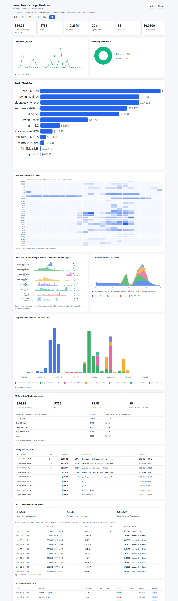

# PowerTokens Usage Dashboard

<p align="center">
  <a href="./README.md">English</a> | <a href="./README.zh.md">简体中文</a>
</p>

<p align="center">
  
  
  
  
</p>

Generate a **single-file offline HTML dashboard** of your (or your team's) model spend on [PowerTokens](https://www.powertokens.ai) — KPIs, cost trends by model / day / modality, and call details — **zero external dependencies, email-friendly, presentation-ready**.

Data comes from PT's **private console API** (per-call exact amount / quota / token), not estimates. As long as you can log into PT in a browser and copy one Cookie, you can pull your entire account history.

---

## Two ways to use this repo

| Usage | For | How |
|---|---|---|
| **① As a standalone Python tool on GitHub** | Anyone using PT (any client) | Clone → install Python → run two commands to get the HTML |
| **② As a WorkBuddy skill** | WorkBuddy users | Drop this folder into `~/.workbuddy/skills/`, then ask "show my PT usage" in chat |

Both share the same `scripts/*.py` with identical logic. Section ① is the primary path; ② is covered at the end.

> **The key point:** This repo is just a set of **pure standard-library Python scripts** run from a terminal. Any agent or editor that gives you a shell can run it — Trae, Cursor, VS Code, dsh, Claude Code, Codex, or even system PowerShell / bash — **no binding to WorkBuddy**. Only the "call ↔ conversation attribution" feature is WorkBuddy-specific (it reads WB local logs).

---

## Screenshots

Real data shown (English UI, the default). Switch the dashboard language anytime at the top-right of the page:



---

## Quick Start (3 steps)

### 1. Prepare Python
Only **Python 3.8+ standard library** is needed — no `pip install`.
```bash
python3 --version   # or python --version
```

### 2. Get your session token (key step)
1. Log into https://www.powertokens.ai in your browser, open the "Usage / Spend" page.
2. Press `F12` → **Application** → **Cookies** → site `https://www.powertokens.ai`.
3. Find the cookie named **`_Bearer`**, copy its **Value (the whole JWT)**.
4. Copy `config.example.json` to `config.json` and paste the token:
   ```json
   { "base_url": "https://www.powertokens.ai/api", "session_token": "paste _Bearer value here" }
   ```
   > `config.json` is in `.gitignore` and **won't** be committed. You can also use env var `PT_SESSION_TOKEN` or the `--token` argument.

### 3. Fetch data + build dashboard
```bash
python3 scripts/fetch_pt_server.py --since 2025-01-01
python3 scripts/gen_dashboard.py --out pt-usage.html
```
Open the generated `pt-usage.html` in a browser. **No URL, no server running** — it's just a local file.

> **One click:** Or just run `./run.sh` (macOS/Linux, `./run.sh zh` for Chinese) or `run.bat` (Windows) at the repo root — it does both steps for you.

---

## Updating (if you already installed it)

| How you installed it | How to update |
|---|---|
| **Cloned with git** | `cd pt-usage-dashboard && git pull` — your `config.json` and cached `pt_usage_server*.json` are gitignored, so they are never overwritten or deleted. |
| **Copied / downloaded the folder** (e.g. installed as a WorkBuddy skill) | Re-download the latest version and replace the folder. Keep your old `config.json` (or simply re-fill your token afterwards) — everything else can be overwritten. |

After updating, regenerate the dashboard to see the changes: `./run.sh` (or the two commands in Quick Start).

> **Your private files survive an update:** `config.json` (your token), `pt_usage_server*.json` (fetched data), `pt_conversation_map.json` and `*.html` are all listed in `.gitignore`, so `git pull` never touches them.

---

## How to build it in other agents / tools (universal)

No matter which agent you use, the steps are identical — **open its terminal, cd into the repo, run the two commands**:

| Tool | How to open terminal | Where to view HTML |
|---|---|---|
| **Trae** | Bottom Terminal panel (or `Ctrl`+`` ` ``), or search "Terminal" in the command palette | Double-click `pt-usage.html` in the file tree, or open in default browser |
| **Cursor / VS Code** | Menu Terminal → New Terminal (`Ctrl`+`` ` ``) | Same |
| **dsh** | Its shell / terminal | Same |
| **Claude Code / Codex / any CLI agent** | Run shell commands directly in the session | `pt-usage.html` in the same directory |
| **Plain terminal (PowerShell / bash / zsh)** | Just open it | Open the file directly |

Three steps (e.g. Trae / Cursor / VS Code):
1. Put the repo anywhere (clone or unzip), `cd` into it in the terminal.
2. Get `_Bearer` per "Quick Start §2" and put it in `config.json`.
3. Run in terminal:
   ```bash
   python3 scripts/fetch_pt_server.py --since 2025-01-01
   python3 scripts/gen_dashboard.py --out pt-usage.html
   ```
   The generated `pt-usage.html` is a local file — double-click to view in a browser. **No WorkBuddy, no network, no service required.**
   (Find two commands tedious? `./run.sh` / `run.bat` at the repo root does both.)

---

## UI Language (Chinese / English, default English)

- **English by default.** A `中文 / EN` toggle sits at the top-right; click to switch. The choice is saved in the browser `localStorage` and persists.
- You can also fix the default language at build time:
  ```bash
  python3 scripts/gen_dashboard.py --lang en    # English (default)
  python3 scripts/gen_dashboard.py --lang zh    # Chinese
  ```
  This only sets the **initial** language; the in-page button can still switch anytime.

---

## Multi-account (when you have several PT logins)

One `_Bearer` = one PT login. If you have 2+ logins, use the `accounts` list in `config.json`:

```json
{
  "base_url": "https://www.powertokens.ai/api",
  "accounts": [
    { "name": "Work",  "session_token": "<account A _Bearer>" },
    { "name": "Personal",  "session_token": "<account B _Bearer>" }
  ]
}
```

`fetch_pt_server.py` pulls **each account** (a single expired token is skipped with a warning, others are unaffected), caching to `pt_usage_server_<name>.json`. `gen_dashboard.py` merges all caches and shows an **Account filter bar** at the top.

---

## Optional enhancements (advanced)

| Feature | Script | Notes |
|---|---|---|
| Call ↔ conversation attribution + split by API Key | `join_conversations.py` | Exact per-key totals; maps calls back to WorkBuddy local sessions (**WorkBuddy-only**; hit rate ~10–20%, rest fall under "other clients") |
| Model catalog | `fetch_catalog.py` | Pulls `GET /v1/models` for a model list — **needs a different credential `PT_API_KEY`** (see "Two tokens" below) |
| Local manual log | `pt_log.py` | When no server token, manually log each PT call / parse `need quota` from errors for the real cost |

---

## ⚠️ Three unavoidable pitfalls (handled in code)

1. **No `Bearer ` prefix** on the `Authorization` header — PT's frontend assigns the Cookie value directly, so we send the raw `Authorization: <token>`. Adding `Bearer ` returns `401`.
2. **Server hard-limits 100 rows per page.** The script counts by actual rows returned and uses month→day paging to avoid the deep-paging cap.
3. **`_Bearer` expires with the session (~3 days in practice).** Re-copy the Cookie after expiry — this is PT's auth mechanism, not something the tool can bypass.

---

## Two different tokens (easy to confuse)

| token | What | Used for | Prefix |
|---|---|---|---|
| **`_Bearer` session cookie** | Session credential after logging into PT in browser | `fetch_pt_server.py` pulls **usage/billing** (main path) | raw, **no Bearer** |
| **`PT_API_KEY`** | Access key for PT's public API (with `Bearer`) | `fetch_catalog.py` pulls **model catalog** (`api.powertokens.ai/v1`) | needs `Bearer ` prefix |

The two are **not interchangeable**: only a login session can query usage/billing; the API key cannot retrieve your spend history (the public API has no usage endpoint — we verified this).

---

## Known limitations (honest notes)

- **Keys you were given but can't log into can't be auto-tracked.** The public API has no "usage by key" endpoint; per-call usage lives only behind a login session. Options: ask the key's owner to export a dashboard for you; get the login and use multi-account; or use `pt_log.py` to log manually (not full history).
- The dashboard is a **static snapshot** at build time. To see newer spend, re-run `fetch` + `gen` (the HTML does not live-refresh).
- Session attribution is **WorkBuddy-local-log only**; cross-client calls (dsh / Trae / pt CLI) can't map to a specific chat and show under "other clients (unattributed)".

---

## What the dashboard includes

- **KPIs**: spend in selected range (server-exact) / calls / total tokens / input:output ratio / active days / account balance
- **Time filter bar**: 24h / 3d / 7d / 30d / 90d / All, linked to every chart
- **Cost trend** (daily line), **daily activity** (hour×date heatmap), **token size distribution** (per-model ridge), **0–24h by model**, **daily model usage stacked bars**
- **Cost by model**, **by modality** (video/image/audio/chat), **by API Key** (full precision)
- **Call ↔ conversation attribution**, **call details** (latest 200 shown by default, one click to expand all records)
- Light/dark theme toggle (remembered) plus the top-right **中文 / EN language switch**

---

## ② Optional: install as a WorkBuddy skill

Section ① is the universal path anyone can use. If you happen to be a WorkBuddy user, you can also use it as a skill: drop this folder into `~/.workbuddy/skills/pt-usage-dashboard/`, restart WorkBuddy, then say "show my PT usage" in chat (full steps in `SKILL.md`). **Installing as a skill changes nothing functionally** — it only adds natural-language triggering.

---

## License

[MIT](./LICENSE) © 2026 tjj1234
