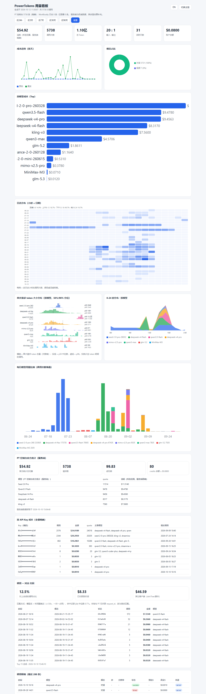

# PowerTokens 用量看板（pt-usage-dashboard）

<p align="center">
  <a href="./README.md">English</a> | <a href="./README.zh.md">简体中文</a>
</p>

<p align="center">
  
  
  
  
</p>

把你（或你的团队）在 [PowerTokens](https://www.powertokens.ai) 上调过的模型消耗，生成一张**单文件离线 HTML 看板**——KPI、按模型/按天/按模态成本趋势、调用明细全都有，**零外部依赖、可邮件转发、可进汇报**。

数据来源是 PT **网页控制台的私有接口**（逐笔精确 amount / quota / token），不靠估算。只要你能登录 PT 网页、复制一个 Cookie，就能拉到你账号的全部历史消耗。

---

## 这个仓库有两种用法

| 用法 | 适合谁 | 怎么用 |
|---|---|---|
| **① 当作 GitHub 上的独立 Python 工具** | 任何用 PT 的人（不限客户端） | 克隆仓库 → 装好 Python → 跑两条命令出 HTML |
| **② 当作 WorkBuddy skill 安装** | WorkBuddy 用户 | 把本目录放进 `~/.workbuddy/skills/`，对话里说"看看我的 PT 用量"即可触发 |

两种方式共用同一套 `scripts/*.py`，逻辑完全一致。下面以①为主说明，②在文末补充。

> **先说清楚本质：** 本仓库就是一组**纯标准库 Python 脚本**，靠终端执行。任何能给你一个 Shell / 终端的 agent 或编辑器都能直接跑——Trae、Cursor、VS Code、dsh、Claude Code、Codex，甚至系统自带的 PowerShell / bash 都行，**和 WorkBuddy 没有绑定关系**。唯一和 WorkBuddy 强绑定的只有"调用↔对话归因"那一项（要读 WB 本地日志）。

---

## 截图预览

示例为真实数据渲染（中文界面）。看板右上角可随时切换中英文：



---

## 快速开始（3 步）

### 1. 准备 Python
只需 **Python 3.8+ 标准库**，无需 `pip install` 任何东西。
```bash
python3 --version   # 或 python --version
```

### 2. 拿到你的会话 token（关键）
1. 浏览器登录 https://www.powertokens.ai ，进入「用量 / 消耗」页面。
2. 按 `F12` 打开开发者工具 → **Application（应用）** → **Cookies** → 站点 `https://www.powertokens.ai`。
3. 找到名为 **`_Bearer`** 的 Cookie，复制它的 **Value（一整串 JWT）**。
4. 把仓库里的 `config.example.json` 复制为 `config.json`，把 token 填进去：
   ```json
   { "base_url": "https://www.powertokens.ai/api", "session_token": "这里粘贴_Bearer的值" }
   ```
   > `config.json` 已被 `.gitignore` 忽略，**不会**被提交，请放心填。也支持环境变量 `PT_SESSION_TOKEN` 或 `--token` 参数传入。

### 3. 拉数据 + 出看板
```bash
python3 scripts/fetch_pt_server.py --since 2025-01-01
python3 scripts/gen_dashboard.py --out pt-usage.html
```
用浏览器打开生成的 `pt-usage.html` 即可。**全程没有网址、没有服务器在跑**，就是写了一个本地文件。

> **一键版：** 也可以直接跑仓库根目录的 `./run.sh`（macOS/Linux，`./run.sh zh` 出中文版）或 `run.bat`（Windows，`run.bat zh`），自动完成「拉数据 → 生成看板」两步。

---

## 更新（已安装的用户）

| 你的安装方式 | 如何更新 |
|---|---|
| **用 git 克隆的** | `cd pt-usage-dashboard && git pull` —— `config.json` 和缓存的 `pt_usage_server*.json` 都在 `.gitignore` 里，不会被覆盖或删除。 |
| **直接复制 / 下载目录的**（比如当 WorkBuddy skill 装） | 重新下载最新版，替换整个目录。保留好旧的 `config.json`（或替换后重新填一次 token），其余文件可以直接覆盖。 |

更新后重新生成看板即可看到变化：`./run.sh`（或跑快速开始里的两条命令）。

> **更新不会弄丢你的私密文件：** `config.json`（你的 token）、`pt_usage_server*.json`（拉取的数据）、`pt_conversation_map.json`、`*.html` 都在 `.gitignore` 里，`git pull` 不会动它们。

---

## 在其它 agent / 工具里怎么产生看板（通用方式）

不管你在哪个 agent 里，步骤一模一样——**找到它的终端，cd 进仓库，跑两条命令**：

| 工具 | 打开终端的方式 | 跑完在哪看 HTML |
|---|---|---|
| **Trae** | 底部 Terminal 面板（或 `Ctrl`+`` ` ``），也可命令面板搜 "Terminal" | 文件树里双击 `pt-usage.html`，或系统默认浏览器打开 |
| **Cursor / VS Code** | 菜单 Terminal → New Terminal（`Ctrl`+`` ` ``） | 同上 |
| **dsh** | 它的 Shell / 终端 | 同上 |
| **Claude Code / Codex / 任何 CLI agent** | 直接在会话里执行 shell 命令 | 同目录的 `pt-usage.html` |
| **纯终端（PowerShell / bash / zsh）** | 直接开 | 直接打开文件 |

具体三步（以 Trae / Cursor / VS Code 为例）：
1. 把仓库放到任意目录（克隆或下载解压），在终端里 `cd` 进去。
2. 按上文「快速开始 §2」拿到 `_Bearer` 填进 `config.json`。
3. 在终端执行：
   ```bash
   python3 scripts/fetch_pt_server.py --since 2025-01-01
   python3 scripts/gen_dashboard.py --out pt-usage.html
   ```
   生成的 `pt-usage.html` 是本地文件，双击即可在浏览器看。**不需要 WorkBuddy、不需要联网、不需要任何服务在跑。**
   （嫌两条命令麻烦？仓库根目录有 `./run.sh` / `run.bat` 一键跑完这两步。）

---

## 界面语言（中 / 英，默认英文）

- **默认英文**。看板右上角有 `中文 / EN` 切换按钮，点一下即切换；选择记在浏览器 `localStorage`，下次打开保持。
- 也可用命令行在生成时固定默认语言：
  ```bash
  python3 scripts/gen_dashboard.py --lang en    # 英文（默认）
  python3 scripts/gen_dashboard.py --lang zh    # 中文
  ```
  该参数只影响"首次打开时"的默认语言；页面内按钮仍可随时切换。

---

## 多账户（你有多个 PT 登录账号时）

一份 `_Bearer` = 一个 PT 登录账号。如果你有 2 个以上能登录的账号，在 `config.json` 用 `accounts` 列表：

```json
{
  "base_url": "https://www.powertokens.ai/api",
  "accounts": [
    { "name": "工作号",  "session_token": "<账号A的_Bearer>" },
    { "name": "个人号",  "session_token": "<账号B的_Bearer>" }
  ]
}
```

`fetch_pt_server.py` 会**逐个账号拉取**（某个 token 过期只跳过并警告，不影响其它），各自缓存为 `pt_usage_server_工作号.json` / `pt_usage_server_个人号.json`。`gen_dashboard.py` 合并所有缓存，看板顶部出现**「账户」筛选条**，可一键只看某个账号。

---

## 可选增强（进阶）

| 功能 | 脚本 | 说明 |
|---|---|---|
| 调用 ↔ 对话归因 + 按 API Key 拆分 | `join_conversations.py` | 按 key 全量精确汇总；把调用对回 WorkBuddy 本地会话（**仅 WorkBuddy 环境有意义**，命中率通常 10~20%，其余归入"其它客户端"） |
| 模型目录对照表 | `fetch_catalog.py` | 拉 `GET /v1/models` 做 PT 当前可用模型对照，**需要另一种凭据 `PT_API_KEY`**（见下方"两种 token 的区别"） |
| 本地手动记录 | `pt_log.py` | 没有服务端 token 时，每次调 PT 后手动记一笔 / 解析报错里的 `need quota` 取真实费用 |

---

## ⚠️ 三个绕不过的坑（已写进脚本，了解即可）

1. **`Authorization` 头不能加 `Bearer ` 前缀。** PT 网页前端是把 Cookie 值直接赋给 `Authorization`，所以我们的请求头也是**原文** `Authorization: <token>`。加了 `Bearer ` 会返回 `401 Login authorization invalid`。
2. **服务端每页硬上限 100 条。** 传 `page_size=200` 也只返 100。脚本按"实际返回条数"累加计账，并采用"按月粗筛 → 对活跃月份按天翻页"规避深翻页上限。
3. **`_Bearer` 随登录会话过期（实测约 3 天）。** 过期后重新复制一次 Cookie 即可。这是 PT 网页鉴权机制决定的，工具侧无法绕开。

---

## 两种 token 的区别（容易混）

| token | 是什么 | 用在哪 | 前缀 |
|---|---|---|---|
| **`_Bearer` 会话 Cookie** | 浏览器登录 PT 后产生的会话凭证 | `fetch_pt_server.py` 拉**用量/账单**（本看板主路） | 原文，**不加 Bearer** |
| **`PT_API_KEY`** | PT 公开 API 的接入 key（带 `Bearer`） | `fetch_catalog.py` 拉**模型目录**（`api.powertokens.ai/v1`） | 需要 `Bearer ` 前缀 |

两者**不是一回事**：只有登录会话能查用量账单，API key 查不到自己的消耗历史（公开 API 压根没有用量端点，我们已探测确认）。

---

## 已知限制（诚实说明）

- **只给 key、登不进账号的"分配 key"无法自动统计。** 公开 API 没有"凭 key 查用量"的接口，逐笔用量只在登录会话接口里。这类账号的消耗：让分配 key 给你的**账号主人**用同款工具导出看板发你；或你拿到该账号登录后复制 `_Bearer` 走多账户方案；或用 `pt_log.py` **本地手动记**作为兜底（非全量历史）。
- 看板是生成那一刻的**静态快照**。要看更新的消耗，重新跑一次 `fetch` + `gen` 即可（HTML 不会被 live 刷新）。
- 会话归因（调用对回哪个聊天）**仅限 WorkBuddy 本地日志**，跨客户端（dsh / Trae / pt CLI）的调用归不到具体会话，会显示在"其它客户端（未归因）"。

---

## 看板包含什么

- **KPI**：所选时间范围的消耗（服务端精确）/ 调用次数 / 总 Token / 输入:输出比 / 活跃天数 / 账户余额
- **时间筛选条**：近 24h / 3天 / 7天 / 30天 / 90天 / 全部，一键联动所有图表
- **成本趋势**（按天折线）、**日活分布**（小时×日期热力图）、**单次请求 token 大小分布**（按模型山脊图）、**0-24 时按模型分布**、**每日模型用量堆叠柱**
- **按模型成本**、**按模态占比**（视频/图像/音频/对话）、**按 API Key 成本**（全量精确）
- **调用 ↔ 对话归因**、**调用明细**（默认显示最近 200 条，一键展开全部记录）
- 深浅色主题切换（记忆偏好），以及右上角 **中文 / EN 语言切换**

---

## ② 可选：当 WorkBuddy skill 安装

上面①是通用主路径，谁都能用。如果你刚好是 WorkBuddy 用户，也可以把它当 skill 用：把本目录整体放到 `~/.workbuddy/skills/pt-usage-dashboard/`，重启 WorkBuddy，之后在对话里说"看看我的 PT 用量""PT 模型消耗看板"即可触发（skill 的 `SKILL.md` 里有完整数据源优先级与执行步骤）。**装不装成 skill 不影响功能**，只是多了"用自然语言触发"这一层便利。

---

## License

[MIT](./LICENSE) © 2026 tjj1234
